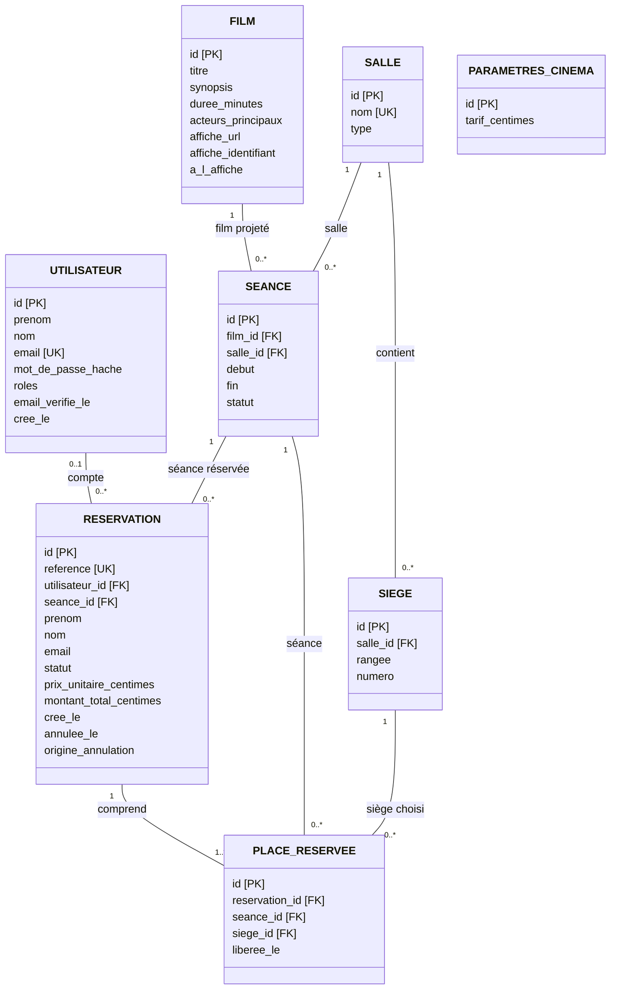

# Modèle de données du Grand Cinéma

Ce modèle décrit les tables utilisées par l’application. Les entités Doctrine et les migrations PostgreSQL définissent leur structure. Les règles de réservation sont vérifiées sur une base de test distincte.

## Vue d'ensemble

Chaque ligne possède un identifiant `id`. Une clé étrangère, notée `FK`, relie cette ligne à une autre table. Par exemple, `film_id` permet de retrouver le film d'une séance.

Le schéma utilise une présentation UML classique, avec un rectangle par table et les cardinalités au bout des relations. `1` signifie exactement un, `0..1` aucun ou un, `0..*` aucun ou plusieurs et `1..*` au moins un.

`PK` désigne la clé primaire, `FK` une clé étrangère et `UK` une valeur unique. Les tables techniques sont détaillées après le schéma métier.

Les noms français facilitent la lecture du schéma. Les tables du code portent les noms suivants.

| Schéma | Table PostgreSQL | Classe Doctrine |
| --- | --- | --- |
| Utilisateur | `user` | `User` |
| Film | `film` | `Film` |
| Salle | `room` | `Room` |
| Siège | `seat` | `Seat` |
| Séance | `screening` | `Screening` |
| Réservation | `reservation` | `Reservation` |
| Place réservée | `reserved_seat` | `ReservedSeat` |
| Paramètres cinéma | `cinema_settings` | `CinemaSettings` |

## Comptes et coordonnées

Le rôle distingue les clients, les employés et la direction. L'inscription publique crée uniquement un compte client. L'adresse e-mail est normalisée avant enregistrement et doit être unique parmi les comptes.

`email_verifie_le` reste vide tant que l'adresse du compte n'a pas été validée. Aucun mot de passe en clair n'est conservé.

`utilisateur_id` est facultatif dans une réservation. Le nom, le prénom et l'e-mail de contact sont enregistrés même si le client n'a pas de compte. Ils restent propres à cette réservation, indépendamment des changements apportés ensuite au profil.

Après vérification de son adresse, un client retrouve les réservations sans compte associées à cette même adresse. La seule saisie d'une adresse lors de l'inscription ne suffit pas à donner accès aux réservations.

## Films, salles et séances

La durée d'un film est un nombre entier de minutes strictement positif. Les acteurs restent un champ texte, car l'application ne prévoit pas de gérer leurs fiches séparément. L'affiche est conservée dans Cloudinary. La base contient son URL et son identifiant, nécessaire pour la remplacer ou la supprimer.

Un siège appartient à une seule salle. Le couple rangée et numéro est unique dans cette salle. La capacité est calculée en comptant les sièges, pour éviter un écart entre une capacité saisie et le plan de salle.

Une séance concerne un film et une salle. Son heure de fin est calculée à partir de la durée du film et conservée. Si cette durée change, Symfony recalcule la fin des séances à venir non annulées et vérifie que l'heure de marge reste respectée. Si un conflit apparaît, la modification est refusée. Sinon, la durée et les heures de fin concernées sont mises à jour dans une même transaction. Les séances passées conservent leurs horaires.

Les dates sont enregistrées en UTC et affichées à l'heure de Paris. Symfony vérifie les chevauchements et l’heure de marge entre deux séances dans une même salle. Les modifications du planning et des durées prennent un verrou PostgreSQL commun pour éviter que deux demandes simultanées créent un conflit.

Les statuts enregistrés pour une séance sont `scheduled` et `cancelled`, affichés comme « Programmée » et « Annulée ». Une séance passée se reconnaît à son horaire. Les règles de modification et le délai de 24 heures restent contrôlés par Symfony.

## Réservations et tarifs

Une réservation concerne une seule séance et au moins un siège. Ses statuts sont `confirmed` et `cancelled`. Le paiement ayant lieu au cinéma, aucun statut de paiement n'est ajouté.

Les champs `tarif_centimes`, `prix_unitaire_centimes` et `montant_total_centimes` distinguent le tarif actuel d’une place, le prix d’une place confirmé lors de la réservation et le montant de toutes les places réservées.

Les montants sont stockés en centimes entiers. Par exemple, 10,50 € devient `1050`. Le tarif et le prix unitaire doivent être strictement positifs. Symfony calcule le total à partir du nombre de places et du prix unitaire, sans reprendre un montant envoyé par le navigateur.

`PARAMETRES_CINEMA` contient une seule ligne pour le tarif global. Ce tarif est recopié dans chaque nouvelle réservation. Le prix unitaire et le total confirmés ne changent plus après son enregistrement, même si la direction modifie le tarif.

La référence est unique, mais ne donne pas à elle seule le droit de consulter une réservation. Symfony vérifie le compte connecté ou le lien personnel sécurisé avant d'afficher les informations ou de générer le PDF.

## Sièges réservés et annulations

Une réservation de trois places possède trois lignes dans `PLACE_RESERVEE`. Elles conservent les sièges choisis, y compris après une annulation.

`liberee_le` reste vide tant que la place est réservée. À l'annulation, cette date est renseignée pour toutes les places de la réservation. Elles redeviennent disponibles sans effacer l'historique.

PostgreSQL impose l’unicité du couple séance et siège uniquement pour les lignes dont `liberee_le` est vide. Un index unique partiel permet cette protection. Ainsi, le même siège peut figurer dans plusieurs réservations annulées, mais dans une seule réservation active pour une séance donnée.

`seance_id` figure aussi dans `PLACE_RESERVEE` pour permettre cette protection. Symfony vérifie qu’il correspond à la séance de la réservation et que le siège appartient à la salle concernée. Les clés étrangères garantissent l’existence des lignes référencées. Elles ne vérifient pas, à elles seules, que leurs salles correspondent.

La confirmation est enregistrée dans une transaction, c'est-à-dire une opération validée entièrement ou annulée entièrement. Si l'un des sièges est déjà pris, aucune réservation ni place du second client ne sera enregistrée.

L’annulation modifie le statut de la réservation et libère toutes ses places dans une même transaction. Symfony vérifie le délai de deux heures à la confirmation. L’annulation d’une séance annule ses réservations encore actives et libère leurs places.

`cancellation_origin` distingue une annulation par le client (`client`) d’une annulation de séance par le cinéma (`cinema`). L’origine d’une réservation déjà annulée reste inchangée. Les anciennes annulations dont l’origine est inconnue conservent une valeur vide.

Les séances, réservations et sièges référencés dans l’historique ne sont pas supprimés en cascade.

## Données techniques

`reservation.confirmation_key` est unique. Son empreinte `request_fingerprint` permet de reconnaître une nouvelle tentative de la même demande et de retrouver la réservation déjà créée. Les dates `confirmation_email_attempted_at` et `confirmation_email_sent_at` suivent les essais d’envoi du mail de confirmation.

La table `screening_notice` conserve les notifications de changement d’horaire et d’annulation de séance. Chaque notification est liée à une réservation. Elle contient son objet, son texte, sa date de création, la dernière tentative et la date d’envoi. Une notification non envoyée reste disponible pour une nouvelle tentative depuis l’administration.

La table `sessions` conserve les sessions Symfony en production. Elle est gérée par le gestionnaire de sessions et exclue du modèle ORM. Les liens d’activation, de réinitialisation et d’accès aux réservations sont signés et ont une date d’expiration. Aucun mot de passe en clair n’est stocké pour ces liens.

## Vérifications

Les tests PHP contrôlent les autorisations, les horaires limites, les libérations de sièges et les nouvelles tentatives. Deux processus PHP séparés confirment aussi des réservations concurrentes sur PostgreSQL pour vérifier qu’un siège ne peut pas être réservé deux fois.

[Documentation PostgreSQL sur les index uniques partiels](https://www.postgresql.org/docs/18/indexes-partial.html).
