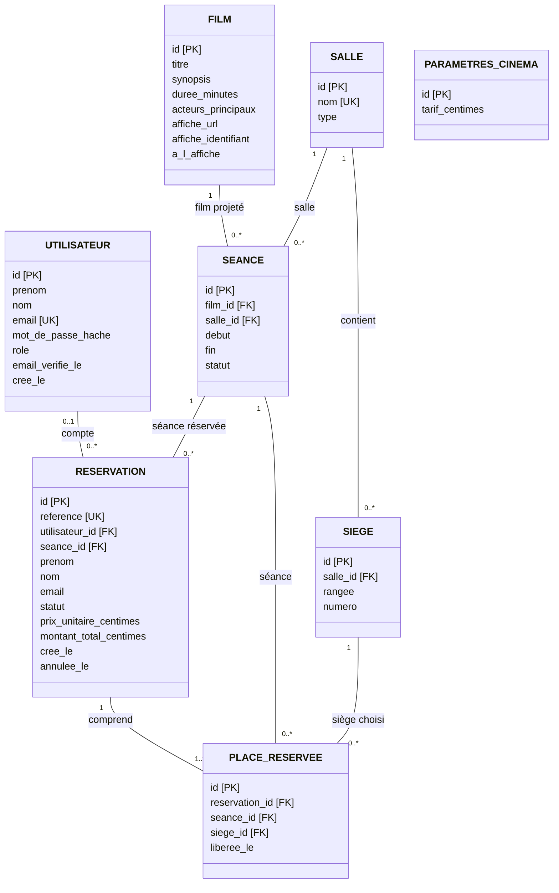

# Modèle de données du Grand Cinéma

Ce modèle décrit les données métier de la première version. Il prépare les entités Symfony et les migrations PostgreSQL. Les tables et les protections décrites ici ne sont pas encore installées ni testées.

## Vue d'ensemble

Chaque ligne possède un identifiant `id`. Une clé étrangère, notée `FK`, relie cette ligne à une autre table. Par exemple, `film_id` permet de retrouver le film d'une séance.

Le schéma utilise une présentation UML classique, avec un rectangle par table et les cardinalités au bout des relations. `1` signifie exactement un, `0..1` aucun ou un, `0..*` aucun ou plusieurs et `1..*` au moins un.

`PK` désigne la clé primaire, `FK` une clé étrangère et `UK` une valeur unique. Les champs techniques supplémentaires seront précisés lors de l’implémentation.

Les noms français servent à lire le schéma. Leur correspondance avec les classes et colonnes du code sera précisée lors de la création des entités.

## Comptes et coordonnées

Le rôle distingue les clients, les employés et la direction. L'inscription publique crée uniquement un compte client. L'adresse e-mail est normalisée avant enregistrement et doit être unique parmi les comptes.

`email_verifie_le` reste vide tant que l'adresse du compte n'a pas été validée. Aucun mot de passe en clair n'est conservé.

`utilisateur_id` est facultatif dans une réservation. Le nom, le prénom et l'e-mail de contact sont enregistrés même si le client n'a pas de compte. Ils restent propres à cette réservation, indépendamment des changements apportés ensuite au profil.

Après vérification de son adresse, un client pourra retrouver les réservations sans compte associées à cette même adresse. La seule saisie d'une adresse lors de l'inscription ne suffit pas à donner accès aux réservations.

## Films, salles et séances

La durée d'un film est un nombre entier de minutes strictement positif. Les acteurs restent un champ texte, car l'application ne prévoit pas de gérer leurs fiches séparément. L'affiche est conservée dans Cloudinary. La base contient son URL et son identifiant, nécessaire pour la remplacer ou la supprimer.

Un siège appartient à une seule salle. Le couple rangée et numéro est unique dans cette salle. La capacité est calculée en comptant les sièges, pour éviter un écart entre une capacité saisie et le plan de salle.

Une séance concerne un film et une salle. Son heure de fin est calculée à partir de la durée du film et conservée. Si cette durée change, Symfony recalcule la fin des séances à venir non annulées et vérifie que l'heure de marge reste respectée. Si un conflit apparaît, la modification est refusée. Sinon, la durée et les heures de fin concernées sont mises à jour dans une même transaction. Les séances passées conservent leurs horaires.

Les dates sont enregistrées en UTC et affichées à l'heure de Paris. Symfony vérifiera les chevauchements et l'heure de marge entre la fin d'une séance et le début de la suivante dans une même salle. Deux changements simultanés du planning devront aussi respecter cette règle.

Les statuts prévus pour une séance sont `programmee` et `annulee`. Une séance passée se reconnaît à son horaire. Les règles de modification et le délai de 24 heures restent contrôlés par Symfony.

## Réservations et tarifs

Une réservation concerne une seule séance et au moins un siège. Ses statuts sont `confirmee` et `annulee`. Le paiement ayant lieu au cinéma, aucun statut de paiement n'est ajouté.

Les champs `tarif_centimes`, `prix_unitaire_centimes` et `montant_total_centimes` distinguent le tarif actuel d’une place, le prix d’une place confirmé lors de la réservation et le montant de toutes les places réservées.

Les montants sont stockés en centimes entiers. Par exemple, 10,50 € devient `1050`. Le tarif et le prix unitaire doivent être strictement positifs. Symfony calcule le total à partir du nombre de places et du prix unitaire, sans reprendre un montant envoyé par le navigateur.

`PARAMETRES_CINEMA` contient une seule ligne pour le tarif global. Ce tarif est recopié dans chaque nouvelle réservation. Le prix unitaire et le total confirmés ne changent plus après son enregistrement, même si la direction modifie le tarif.

La référence est unique, mais ne donne pas à elle seule le droit de consulter une réservation. Symfony vérifiera le compte connecté ou le lien personnel sécurisé avant d'afficher les informations ou de générer le PDF.

## Sièges réservés et annulations

Une réservation de trois places possède trois lignes dans `PLACE_RESERVEE`. Elles conservent les sièges choisis, y compris après une annulation.

`liberee_le` reste vide tant que la place est réservée. À l'annulation, cette date est renseignée pour toutes les places de la réservation. Elles redeviennent disponibles sans effacer l'historique.

PostgreSQL devra imposer l'unicité du couple séance et siège uniquement pour les lignes dont `liberee_le` est vide. Un index unique partiel permet cette protection. Ainsi, le même siège peut figurer dans plusieurs réservations annulées, mais dans une seule réservation active pour une séance donnée.

`seance_id` figure aussi dans `PLACE_RESERVEE` pour permettre cette protection. Il devra obligatoirement correspondre à la séance de la réservation. Le siège devra appartenir à la salle de cette séance. Ces liens seront contrôlés lors de l'implémentation, avec les contraintes de base adaptées.

La confirmation sera enregistrée dans une transaction, c'est-à-dire une opération validée entièrement ou annulée entièrement. Si l'un des sièges est déjà pris, aucune réservation ni place du second client ne sera enregistrée.

L'annulation devra modifier le statut de la réservation et libérer toutes ses places dans une même transaction. Symfony vérifiera le délai de deux heures au moment de confirmer l'annulation. L'annulation d'une séance devra également annuler ses réservations et libérer leurs places.

Les séances, réservations et sièges référencés dans l'historique ne seront pas supprimés en cascade.

## Données techniques à compléter

Ce schéma couvre les données métier. Les champs ou tables nécessaires aux sessions de connexion, aux liens d'activation, à la récupération du mot de passe, aux liens personnels des réservations et au suivi des e-mails seront ajoutés avec ces fonctionnalités.

Une clé de confirmation unique sera également prévue pour qu'une nouvelle tentative de la même demande ne crée pas une seconde réservation. Les contrôles de double réservation, d'annulation et de nouvelle tentative devront être testés sur PostgreSQL.

## Référence technique

[Documentation PostgreSQL sur les index uniques partiels](https://www.postgresql.org/docs/18/indexes-partial.html). Cette protection sera créée dans une migration et vérifiée avec deux réservations concurrentes.
